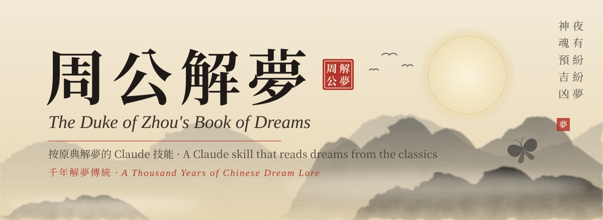
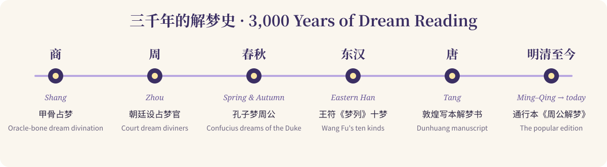
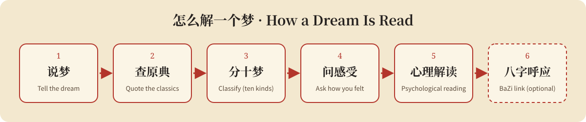

# 周公解梦 · The Duke of Zhou's Book of Dreams

<p align="center">
  
</p>

<p align="center">
  <a href="LICENSE"></a>
  
  
  
  
</p>

**做了一个梦，想知道它是什么意思？** 告诉 Claude 你梦到了什么，它会像一位熟读古书的老先生那样，翻开两千多年传下来的解梦典籍，告诉你古人怎么看这个梦，再用今天的心理学帮你想想：这个梦可能在说你心里的什么事。

**Had a dream and wondering what it means?** Tell Claude what you dreamed. Like an old scholar who knows the classics by heart, it opens China's traditional dream books, shows you how people have read that dream for centuries, and then uses modern psychology to help you think about what it might be saying about your life right now.

---

## 解梦是什么？｜ What is dream interpretation?

解梦，就是给梦"翻译"意思。中国人自古相信梦不是随便做的：梦里出现的东西，比如蛇、水、牙齿、过世的亲人，都像一种暗号，可能在提示吉凶、预告将来，也可能反映你白天放不下的心事。解梦就是把这些暗号读出来。

Dream interpretation means "translating" a dream. Since ancient times, Chinese people have believed that dreams are not random. What appears in them, whether a snake, water, falling teeth or a relative who has passed away, works like a coded message. It may hint at good or bad luck, foretell what is coming, or reflect worries you carry during the day. Dream interpretation is the art of reading those messages.

## 一段很长的历史 ｜ A very long history

<p align="center"></p>

| 时代 Era | 发生了什么 What happened |
|---|---|
| **商朝**（3000 多年前）· **Shang dynasty** (over 3,000 years ago) | 商人相信梦是和祖先魂灵沟通的桥梁。商王梦见祖先后，会在甲骨上占问吉凶，这是目前能看到的最早的占梦记录。 · The Shang saw dreams as a bridge to ancestral spirits. After dreaming of an ancestor, the king had the dream divined on oracle bones, the earliest dream records we have. |
| **西周** · **Western Zhou** | 占梦被纳入国家礼制，朝廷设"占梦"官，专管《周礼》所说的"六梦"：正梦、噩梦、思梦、寤梦、喜梦、惧梦。 · Dream divination became part of state ritual. Court officials handled the "six dreams" of the *Rites of Zhou*: ordinary, frightening, longing, waking-thought, joyful and fearful dreams. |
| **春秋** · **Spring and Autumn period** | 孔子晚年叹"久矣吾不复梦见周公"（《论语》）。周公从此和"梦"连在一起，"周公之梦"成了梦的代称，后世解梦书都托他的名字。 · In old age Confucius sighed that he no longer dreamed of the Duke of Zhou (*Analects*). The Duke became linked with dreams, and later dream books took his name. |
| **秦** · **Qin dynasty** | 岳麓书院藏秦简里有一部体例完整的《占梦书》，梦象和占语都已固定，说明梦书开始独立成书流传。 · Qin bamboo slips held at the Yuelu Academy include a complete *Book of Dream Divination* with fixed dream images and readings, the first sign of dream books circulating on their own. |
| **汉** · **Han dynasty** | 《汉书·艺文志》著录了《黄帝长柳占梦》等梦书。东汉王符在《潜夫论·梦列》提出"十梦"，强调同一个梦要看做梦人的心情和处境来解。本技能收录了这篇全文。 · The Han imperial bibliography lists several dream books. Wang Fu's "On Dreams" set out ten kinds of dreams and stressed reading a dream through the dreamer's feelings and situation. Its full text is included here. |
| **隋** · **Sui dynasty** | 《隋书·经籍志》录有《解梦书》二卷，这是书名里第一次出现"解梦"二字，在此之前都叫"占梦"。 · The Sui bibliography lists a *Book of Dream Interpretation* in two scrolls, the first title to use the word *jiemeng* ("interpreting dreams") instead of *zhanmeng* ("divining dreams"). |
| **唐、五代** · **Tang & Five Dynasties** | 敦煌出土了《周公解梦书》《新集周公解梦书》《先贤周公解梦书》等多种写本，内容各不相同，都没有署作者名。 · Dunhuang yielded several manuscripts under the Duke of Zhou's name, each with different contents and none naming an author. |
| **宋** · **Song dynasty** | 《宋史·艺文志》第一次在正史书目里著录"《周公解梦书》三卷"，可惜已经失传。 · The Song official history is the first state bibliography to record a *Duke of Zhou's Book of Dreams* in three scrolls; that edition is now lost. |
| **明清至今** · **Ming–Qing to today** | 各种版本渐渐统一成今天流传的七言条目本，甚至被刻在石碑上嵌在周公庙大殿外墙。明代陈士元写《梦占逸旨》，把梦分成九类。本技能收录的就是这部通行本，共 27 章、988 条。 · The many versions gradually merged into today's popular edition of seven-character entries, which was even carved in stone on the walls of a Duke of Zhou temple. The Ming scholar Chen Shiyuan's *Mengzhan Yizhi* sorted dreams into nine kinds. This skill contains the full popular edition: 27 chapters, 988 entries. |

> **谁写的？什么时候写的？** · **Who wrote it, and when?** 学界公认《周公解梦》不是周公本人所写，而是后人汇集民间经验、借他的名字成书。至于具体年代，有学者（如刘文英）认为出自三国东吴，也有人根据史书著录推断是南北朝到隋唐，目前没有定论。
> Scholars agree the book was not written by the Duke of Zhou himself; it collects folk wisdom under his name. Its date is debated: some, such as Liu Wenying, place it in the Three Kingdoms state of Wu, while others argue for the Northern and Southern dynasties through the Tang. There is no consensus.

## 古人怎么"读"梦：取象比类 ｜ How the ancients read dreams: reasoning by image and analogy

《周公解梦》不讲梦从哪里来，只关心梦**预示什么**。它的核心方法叫**"取象比类"**：把梦里看到的东西当成符号，按联想推出吉凶。联想主要有三个来源：

The book doesn't ask where dreams come from, only **what they foretell**. Its core method is *quxiang bilei*, "taking the image and reasoning by analogy": each thing seen in a dream is treated as a symbol, and its meaning is worked out by association. Those associations come from three main places:

| 来源 Source | 例子 Example |
|---|---|
| **常识和五行** · **Common sense and the Five Phases** | 水象征滋润，火象征温暖兴旺，太阳象征阳刚和男子，月亮象征阴柔和女子，所以有「日入懷貴子月女」。 · Water nourishes, fire brings warmth and prosperity, the sun stands for men and the moon for women, hence "The sun enters your arms: a son; the moon: a daughter." |
| **古代的著名梦例** · **Famous dreams of the past** | 春秋时燕姞梦见兰花后生下儿子，于是"梦兰"成了怀孕的吉兆。 · A noblewoman named Yan Ji dreamed of an orchid and bore a son, so dreaming of orchids came to signal pregnancy. |
| **谐音和拆字** · **Puns and character play** | "棺材"谐音"官"和"财"，所以原书说「棺殮死人主得財」，梦见棺材反而是吉兆。古人还会把梦拆成汉字来解，见下面"苻融解梦破案"。 · *Guancai* (coffin) sounds like *guan* (office) and *cai* (wealth), so the book says "Placing the dead in a coffin: you gain wealth." Interpreters also turned dream images into Chinese characters; see the detective story below. |

除了照字面解（梦见什么应什么）和看象征，古人也会**反着解**：民间常说"梦是反的"，原书里很多吓人的梦都判为吉，比如「放聲大哭歡樂至」。

Besides literal and symbolic readings, there was also **reverse reading**. "Dreams mean the opposite" is a common saying, and the book judges many frightening dreams as lucky, such as "Crying out loud: joy is coming."

## 那些有名的梦 ｜ Famous dreams in Chinese history

许多中文成语和故事都来自梦，至今还在日常使用：

Many Chinese idioms and stories come from dreams and are still used every day:

- **病入膏肓** · *bing ru gao huang*, "the illness has reached where no cure can go." 据《左传》，晋景公梦见厉鬼，又梦见病魔化作两个小孩，躲进"膏"与"肓"之间，医生说那里药力达不到，景公不久病死。今天用来形容情况已经无法挽救。
  According to the *Zuo Zhuan*, Duke Jing of Jin dreamed that his illness, as two children, hid between his heart and diaphragm, where no medicine could reach; he soon died. The phrase now means a situation is beyond saving.
- **黄粱一梦** · *huangliang yi meng*, "a dream while the millet cooks." 唐代小说《枕中记》里，卢生在梦中享尽一生荣华，醒来锅里的黄米饭还没煮熟。比喻荣华富贵转眼成空。
  In the Tang story *The World Inside a Pillow*, a young man lives a whole life of glory in a dream and wakes before his millet has finished cooking. It means worldly success is fleeting.
- **庄周梦蝶** · *Zhuangzi dreams of a butterfly.* 庄子梦见自己变成蝴蝶，醒来后不知道是自己梦见了蝴蝶，还是蝴蝶梦见了自己。《周公解梦》开篇诗就提到这个典故，本仓库封面上的蝴蝶也是取这个意思。
  Zhuangzi dreamed he was a butterfly and woke unsure whether he had dreamed the butterfly or the butterfly was dreaming him. The book's opening poem alludes to it, and so does the butterfly on this repository's banner.
- **苻融解梦破案** · *Fu Rong solves a murder through a dream.* 据《晋书》，有人梦见骑马过河、水里有两个太阳，官员苻融把梦拆成字："马"在左、水在旁成"冯"，两个"日"叠起来成"昌"，于是抓到了真凶冯昌。
  According to the *Book of Jin*, a man dreamed of riding a horse through water containing two suns. The official Fu Rong read the images as characters: horse beside water makes 冯 (Feng), two suns stacked make 昌 (Chang). The real murderer turned out to be one Feng Chang.

## 今天怎么看 ｜ How we see it today

- **它是一本"词典"，不是一套理论。** 书里只有一条条结论，没有解释为什么；同一个梦有时既说吉又说凶。
  **It's a dictionary, not a theory.** It lists verdicts without reasons, and the same dream is sometimes read as both lucky and unlucky.
- **它属于它的时代。** 书里的世界是古代农业社会：官位、妻妾、奴婢、科举。一千年后同样的梦，未必还是同样的意思。
  **It belongs to its era.** Its world is one of rural life, official rank, concubines and imperial exams; the same dream a thousand years later need not mean the same thing.
- **心理学给了新角度。** 弗洛伊德、荣格等人认为梦大多是潜意识的表达。很多人今天读《周公解梦》，看重的不是预言，而是它带来的**心理暗示**：一个好梦让人醒来心情好，做事更有信心，好事反而更容易发生。
  **Psychology adds a new angle.** Freud, Jung and others saw dreams mainly as expressions of the unconscious. Many readers today value the book less as prophecy than as **positive suggestion**: a good dream lifts your mood, you act with more confidence, and good things become more likely.

这也是本技能的做法：**古书怎么说，原样告诉你；你心里可能在想什么，用心理学帮你想；最后由你自己判断。**
That is how this skill works: **it tells you exactly what the classics say, helps you reflect on what the dream may mean for you psychologically, and leaves the judgement to you.**

## 中国人怎么用？为什么用？｜ How and why do Chinese people use it?

**怎么用 · How it's used**

- **早上醒来查一查**：梦到掉牙、蛇、发大水，很多人第一反应是"查查周公解梦"。这句话在中文里几乎是口头禅。
  **A morning lookup.** Dream of losing teeth, a snake or a flood, and many people's first thought is "let me check the Duke of Zhou." The phrase is practically an everyday expression.
- **家人朋友之间聊**：和妈妈、闺蜜说"我昨晚梦到……"，一起猜是好是坏，是很日常的话题。
  **Talking it over.** Telling your mum or a close friend "I dreamed last night that…" and guessing together whether it's a good sign is an ordinary part of family life.
- **"胎梦"**：怀孕前后梦到蛇、龙、鱼、果子，很多家庭会当作孩子来临的征兆，原书里就有「蛇入懷中生貴子」。
  **"Pregnancy dreams".** Many families take dreams of snakes, dragons, fish or fruit around pregnancy as signs of a baby on the way. The book itself says "A snake enters your arms: a distinguished child will be born."
- **人生关口的心理安慰**：考试、找工作、结婚、搬家之前，做了个梦，查一查求个心安。
  **Reassurance at turning points.** Before an exam, a job search, a wedding or a move, people look up a dream for peace of mind.

**为什么用 · Why people use it**

- **梦让人困惑，人想找到意义。** 解梦给混乱的梦一个说法，让人安心。
  **Dreams are puzzling, and people look for meaning.** Interpretation gives a confusing dream a story and settles the mind.
- **"梦是反的"带来安慰。** 民间常说梦是反的，原书里也有很多"凶梦反吉"的条目，比如「放聲大哭歡樂至」：梦里大哭，预示欢乐要来。做了噩梦的人，能在这里松一口气。
  **"Dreams mean the opposite" is comforting.** A common saying holds that dreams run in reverse, and the book has many frightening dreams read as lucky, e.g. "Crying out loud: joy is coming." Someone shaken by a nightmare can breathe easier.
- **"日有所思，夜有所梦"。** 中国人早就明白，梦反映白天的心事。解梦其实也是一种看见自己情绪的方式，这和现代心理学的看法相通。
  **"What you think by day, you dream by night."** Chinese tradition long recognised that dreams mirror waking concerns. Interpreting a dream is also a way of noticing your own feelings, an idea modern psychology shares.
- **它是一种文化。** 多数人不会把解梦当成真的预言，而是当作有趣、亲切的传统，就像西方人读星座一样。
  **It's culture.** Most people don't treat it as literal prophecy but as a warm, fun tradition, much as many people in the West read horoscopes.

## 这个技能能帮你做什么？｜ What this skill does for you

<p align="center"></p>

你只要描述梦，它会：
Just describe your dream, and it will:

1. **告诉你古书原文怎么说**：逐条引用《周公解梦》原文，附白话或英文解释；原书没有的就直说"原书未收"，绝不编造。
   **Show you what the classics actually say**, quoting the original entries with a plain-language or English explanation. If the book has no entry, it says so and never makes one up.
2. **判断这是哪一类梦**：按王符的"十梦"，比如是"日有所思"的想梦，还是"梦是反的"的反梦。
   **Tell you what kind of dream it is**, using Wang Fu's ten categories, such as a dream of daytime thoughts or a dream that means the opposite.
3. **问你梦里的感受**：古人认为，梦里开心才是真吉，梦里害怕才要当心。
   **Ask how you felt in the dream.** The ancients held that a dream is truly lucky only if you felt joy in it, and a warning only if you felt fear.
4. **用心理学说说你的心事**：这个梦可能和你最近的压力、期待或担心有什么关系。
   **Offer a psychological reading** of how the dream may connect to your recent stress, hopes or worries.
5. **（可选）结合你的八字**：如果你提供生辰，看看做梦那晚的运势和你命盘的呼应。
   **(Optional) Link it to your BaZi chart.** If you share your birth details, it relates the night of the dream to your Four Pillars chart.

中文问就中文答，英文问就英文答。
Ask in Chinese and it answers in Chinese; ask in English and it answers in English.

---

## 特点 ｜ Features

| 中文 | English |
|---|---|
| **引经据典，不编原文**：先查原文条目原样引用；原书没有就明说"未收此条"，不编造 | **Cited, never invented:** quotes matching entries verbatim; if the text has no entry, it says so instead of making one up |
| **十梦分类**：按《梦列》把梦归入直、象、精、想、人、感、时、反、病、性十类 | **Ten kinds of dreams:** classifies each dream using *Menglie*'s ten categories |
| **感受定吉凶**：依《梦列》"梦吉事而己意大喜乐……则真吉"，先问梦里的感受 | **Feeling decides the omen:** following *Menglie*, the dreamer's emotion in the dream comes first |
| **反梦提示**：原文本身判为吉的"凶象"会如实说明，不吓人 | **Reversals explained:** frightening images the text itself reads as auspicious are explained calmly |
| **心理学视角**：每次都附一段现实心事的解读 | **Psychological reading:** every interpretation links the dream to waking concerns |
| **八字联动（可选）**：若有命盘，看做梦当晚的流年、流月、流日与原局的呼应 | **Optional BaZi link:** if a chart is available, relates the night's pillars to the natal chart |
| **中英双语**：用户用什么语言就用什么语言回答，原文始终保留 | **Bilingual:** replies in the user's language and always keeps the original Chinese |

## 内容 ｜ Contents

```
zhougong-jiemeng/
├── SKILL.md                                      # 技能说明（中英对照） · Skill instructions (bilingual)
└── references/
    ├── zhougong-jiemeng-original.md              # 《周公解夢》全文 27 章 · Full text, 27 chapters (~900 entries)
    ├── zhougong-jiemeng-selected-en.md           # 86 条精选中英对照 · 86 selected entries, Chinese–English
    └── menglie-zh-en.md                          # 《夢列》全文中英对照 · Full Menglie, Chinese–English
```

## 安装 ｜ Installation

**Claude Code**：把 `zhougong-jiemeng/` 文件夹复制到 `~/.claude/skills/`。
Copy the `zhougong-jiemeng/` folder into `~/.claude/skills/`.

```bash
git clone https://github.com/kkkkkkkaro-cyber/Book-of-Dreams.git
cp -r Book-of-Dreams/zhougong-jiemeng ~/.claude/skills/
```

**Claude 应用 ｜ Claude apps**：把 `zhougong-jiemeng/` 文件夹打包成 zip，在技能设置中上传。
Zip the `zhougong-jiemeng/` folder and upload it as a custom skill.

## 用法示例 ｜ Example

> **用户**：我梦到很多人想和我当室友，梦里有点开心。
>
> **Claude**：
> - 一句话结论：偏吉，属《夢列》所说的"想梦"：「人有所思，即夢其到」。
> - 原典：《周公解夢·帝王文武呼召》「一切貴人皆吉祥」；《船車遊行物件》「與人同船主移居」（类推）……
> - 梦里开心，依《夢列》「己意大喜樂……則真吉矣」，偏向贵人相助一面。

> **User:** I dreamed lots of people wanted to be my roommate, and I felt a bit happy.
>
> **Claude:**
> - Verdict: mildly auspicious, a "reflective" dream in *Menglie*'s terms.
> - Classics: 「一切貴人皆吉祥」 "All noble persons are auspicious"; 「與人同船主移居」 "Sharing a boat with others: you will move house" (by analogy)…

## 版本与来源 ｜ Sources & editions

- **《周公解夢》通行本** · *Zhougong Jiemeng*, popular edition. 来源：[维基文库](https://zh.wikisource.org/wiki/周公解夢)。托名周公旦，实为后世（一般认为明清时期）民间编辑的七言条目梦书，**与敦煌唐写本《新集周公解夢書》不是同一本**。
  Via Wikisource. Attributed to the Duke of Zhou but actually a later popular compilation (generally dated Ming–Qing), **not the Tang-dynasty Dunhuang manuscript**.
- **王符《潛夫論·夢列第二十八》** · Wang Fu, *Qianfu Lun*, ch. 28. 来源：[维基文库](https://zh.wikisource.org/wiki/潛夫論/卷七)。已校正两处繁简转换讹字。
  Via Wikisource; two character-conversion errors corrected.
- 历史、方法与故事部分参考了[百度百科「周公解梦」](https://baike.baidu.com/item/%E5%91%A8%E5%85%AC%E8%A7%A3%E6%A2%A6/1915904)词条及其所引文献（刘玉堂、薛源，《民俗研究》2022；杨自福、顾大勇，《敦煌学辑刊》1995 等），已用自己的话重新撰写。 · The history, methods and stories draw on the Baidu Baike entry on *Zhougong Jiemeng* and the scholarship it cites, rewritten in our own words.
- 英译均为本项目所作。 · All English translations are by this project.

## 作者 ｜ Authors

- **Karo** ([@kkkkkkkaro-cyber](https://github.com/kkkkkkkaro-cyber))：项目发起与策划 · Creator and maintainer
- **Claude** (Anthropic)：资料整理、翻译与编写协助 · Research, translation and writing assistance

欢迎提交 Issue 或 Pull Request，一起完善译文和条目。 · Issues and pull requests to improve the translations and entries are welcome.

## 许可 ｜ License

- 技能说明、英译与整理：MIT（见 `LICENSE`）。 · Skill instructions, translations and arrangement: MIT (see `LICENSE`).
- 两部古籍原文属公有领域。 · The two classical source texts are in the public domain.

## 免责声明 ｜ Disclaimer

解梦仅供文化参考与自我反思，不是预测，也不能替代医疗或心理专业意见。

Dream interpretation here is for cultural interest and self-reflection only. It is not prediction and is no substitute for medical or mental-health advice.
